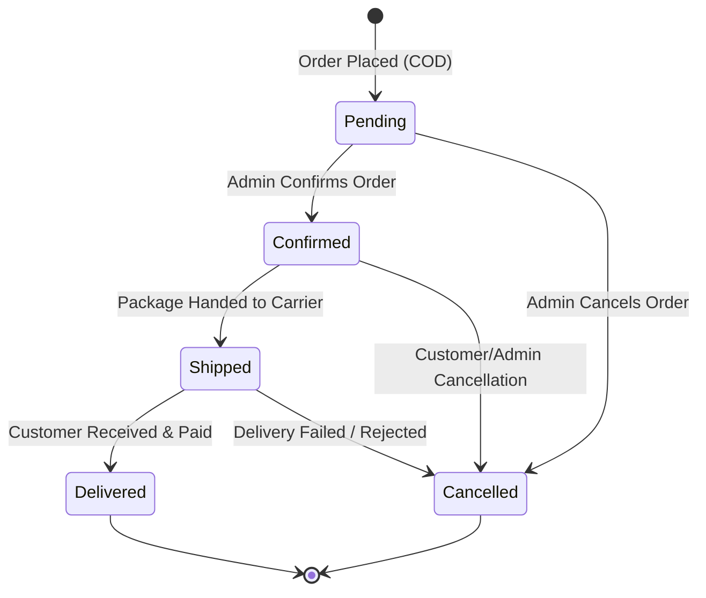

# Admin Panel Specification & UX Design

This document details the functional behavior, user interface layouts, component specifications, and data flow for the **Admin Dashboard** in the Mini E-Commerce project.

---

## 1. Admin Layout & Navigation Architecture

The Admin Panel utilizes a professional layout tailored for administrative workflows:
- **Left Sidebar:** Persistent on desktop (collapsible / overlay drawer on mobile/tablet) containing quick links:
  - 📊 **Dashboard / Overview** (`/admin`)
  - 🏷️ **Categories** (`/admin/categories`)
  - 📦 **Products** (`/admin/products`)
  - 🛍️ **Orders** (`/admin/orders`)
- **Top Header:** Displays active admin profile name (`Store Admin`), quick link back to store (`View Store`), and a **Logout** button.
- **Main View Area:** High-contrast content container with responsive tables, quick filter pills, count badges, and action toolbars.

```text
+--------------------------------------------------------------------------------+
| [Logo] MiniShop Admin   | [View Store]    [Admin Name: Store Admin]   [Logout] |
+-----------------------+--------------------------------------------------------+
|  [Sidebar]            |  [Main Content Header]                                 |
|                       |  Categories Management                [+ Add Category] |
|  📊 Dashboard         |                                                        |
|  🏷️ Categories (3)    |  +--------------------------------------------------+  |
|  📦 Products (12)     |  | Name         | Description        | Actions      |  |
|  🛍️ Orders (7)        |  |--------------+--------------------+--------------|  |
|                       |  | Electronics  | Gadgets & devices  | [Edit] [Del] |  |
|                       |  | Fashion      | Apparel & clothes  | [Edit] [Del] |  |
|                       |  | Shoes        | Casual & sports    | [Edit] [Del] |  |
|                       |  +--------------------------------------------------+  |
+-----------------------+--------------------------------------------------------+
```

---

## 2. Category Management (`/admin/categories`)

### 2.1 Functional Capabilities
- **View Categories:** Responsive table displaying category name, description, and action buttons.
- **Add Category:** Click "+ Add Category" button to open modal dialog.
- **Edit Category:** Click "Edit" icon on table row to pre-populate modal with current category data.
- **Delete Category:** Click "Delete" icon to trigger a **Confirmation Dialog** before executing `DELETE /api/categories/:id`.

### 2.2 Form Fields & Validations
| Field | Type | Required | Client Validation | Backend Constraint |
| :--- | :--- | :--- | :--- | :--- |
| **Category Name** | Text Input | Yes | Non-empty, 2-50 chars | `unique: true`, trimmed |
| **Description** | Textarea | No | Max 250 chars | Trimmed, optional |

### 2.3 UX States
- **Loading State:** Skeleton table rows with pulse animation while fetching.
- **Empty State:** Clean illustration with caption "No categories found. Create your first category to get started."
- **Delete Confirmation:** "Are you sure you want to delete category '{name}'? Products in this category will need reassignment." with [Cancel] and [Confirm Delete] buttons.

---

## 3. Product Management (`/admin/products`)

### 3.1 Functional Capabilities
- **View Products:** Responsive table showing Product Thumbnail, Product Name, Category Badge, Price (formatted `$XX.XX`), Stock status badge (In Stock / Low Stock / Out of Stock), and Actions.
- **Add Product:** Open modal with image URL preview, category select dropdown, and pricing/stock inputs.
- **Edit Product:** Open modal populated with existing product values.
- **Delete Product:** Protected by delete confirmation modal before firing `DELETE /api/products/:id`.

### 3.2 Form Fields & Validations
| Field | Input Control | Required | Validation Rules |
| :--- | :--- | :--- | :--- |
| **Product Name** | Text Input | Yes | 2 to 120 characters, non-empty |
| **Category** | Select Dropdown | Yes | Must select a valid Category ID from existing list |
| **Price** | Number Input (`step="0.01"`) | Yes | Float > 0 (e.g. 19.99) |
| **Stock** | Number Input (`step="1"`) | Yes | Integer >= 0 (e.g. 50) |
| **Image URL** | URL Input | Yes | Valid image URL format; includes instant image preview |
| **Description** | Textarea | Yes | Clear product description (min 10 chars) |

### 3.3 Visual Badges
- **In Stock:** Green pill (`stock > 10`)
- **Low Stock:** Amber pill (`1 <= stock <= 10`)
- **Out of Stock:** Red pill (`stock === 0`)

---

## 4. Order Management (`/admin/orders`)

### 4.1 Order Lifecycle State Machine



### 4.2 Status Badge Visual Styling
| Status | Badge Color (Tailwind) | Description |
| :--- | :--- | :--- |
| **Pending** | `bg-amber-100 text-amber-800 border-amber-300` | Freshly placed order awaiting review |
| **Confirmed** | `bg-blue-100 text-blue-800 border-blue-300` | Order verified and ready for fulfillment |
| **Shipped** | `bg-purple-100 text-purple-800 border-purple-300` | In transit with delivery driver |
| **Delivered** | `bg-emerald-100 text-emerald-800 border-emerald-300` | Successfully delivered and cash collected |
| **Cancelled** | `bg-rose-100 text-rose-800 border-rose-300` | Order voided |

### 4.3 Order Row & Details Drawer
- **Orders Table:**
  - Order ID (truncated hash `#...c030`)
  - Customer Info (Name, Email, Phone)
  - Date & Time
  - Items summary (e.g. "2 items")
  - Total Payable (e.g. `$889.97 [COD]`)
  - Status Dropdown Selector (`Pending`, `Confirmed`, `Shipped`, `Delivered`, `Cancelled`)
- **Order Details Modal / Drawer:**
  - Full shipping address: Address, City, Pincode
  - Detailed product breakdown: Thumbnail, Item title, Unit price snapshot, Quantity, Subtotal
  - Status history & timestamps

---

## 5. UI Feedback & Interaction Standard

1. **Toast Notifications:**
   - On Category create/update/delete: `toast.success("Category saved successfully")`
   - On Product create/update/delete: `toast.success("Product updated successfully")`
   - On Order status change: `toast.success("Order status updated to Shipped")`
   - On any API error: `toast.error(error.response?.data?.message || "Operation failed")`
2. **Confirmation Dialogs:** Never perform destructive `DELETE` actions without an interactive confirmation popup.
3. **Form Disable State:** Disable submission buttons and show inline spinner when an asynchronous request is in flight to prevent duplicate submissions.
