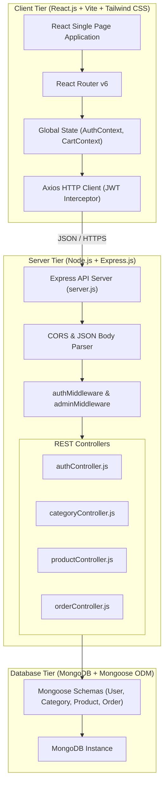

# System Architecture & Technical Design

This document details the architectural design, architectural boundaries, communication patterns, and folder structure for the **Mini E-Commerce Demo Project (MERN Stack)**.

---

## 1. High-Level Architecture Diagram



---

## 2. Architectural Boundaries & Principles

### 2.1 Single Responsibility & Decoupled Layers
- **Client Tier:** Responsible strictly for presentation, client-side routing, user input capture, displaying feedback (toasts, loading spinners, empty states), and retaining ephemeral session state (auth token in `localStorage`, cart in `localStorage`).
- **Server Tier:** Authoritative business logic gatekeeper. Handles request validation, JWT issuance/verification, password hashing, inventory validation, and database operations.
- **Database Tier:** Persistent storage running MongoDB with schema-level constraints enforced via Mongoose ODM.

### 2.2 Client-Server Communication
- All communication between React and Express is performed over standard RESTful JSON HTTP endpoints.
- Base URL is configured in Vite environment (`VITE_API_BASE_URL=http://localhost:5000/api`).
- An Axios instance with request/response interceptors automatically injects the `Authorization: Bearer <token>` header for authenticated requests and handles 401 Unauthorized responses by clearing invalid credentials.

### 2.3 Authoritative Pricing & Inventory State
- **Zero Client Trust:** The frontend cart only contains product IDs and chosen quantities. When placing an order, the server fetches the real-time price and available stock directly from MongoDB.
- **Inventory Safety:** Stock deduction occurs on order placement. If any product in the cart has insufficient stock at the moment of checkout, the order transaction fails cleanly and returns an informative error message.

---

## 3. Directory Layout Specification

### 3.1 Client Directory (`/client`)

```text
client/
├── index.html                    # HTML entry template with meta tags & root div
├── package.json                  # React dependencies, scripts & devDependencies
├── tailwind.config.js            # Tailwind theme, colors, and content paths
├── postcss.config.js             # PostCSS configuration for Tailwind
├── vite.config.js                # Vite build configuration & server proxy
│
└── src/
    ├── main.jsx                  # Application entry point with ReactDOM
    ├── App.jsx                   # Route hierarchy and context providers
    ├── index.css                 # Base Tailwind directives (@tailwind base, etc.)
    │
    ├── assets/                   # Static images, placeholders, and logo assets
    │
    ├── context/                  # React Context for global state
    │   ├── AuthContext.jsx       # User state, login, register, logout helpers
    │   └── CartContext.jsx       # Cart state (items, addItem, removeItem, updateQty, clearCart)
    │
    ├── services/                 # Centralized API network layer
    │   ├── api.js                # Base Axios instance with interceptors
    │   ├── authService.js        # Auth API calls (login, register)
    │   ├── categoryService.js    # Category CRUD calls
    │   ├── productService.js     # Product CRUD & search/filter calls
    │   └── orderService.js       # Customer and Admin order API calls
    │
    ├── components/
    │   ├── common/               # Shared general components
    │   │   ├── Navbar.jsx        # Responsive top navigation with cart count & auth actions
    │   │   ├── Footer.jsx        # Clean footer section
    │   │   ├── Loader.jsx        # Loading spinner for asynchronous data fetching
    │   │   ├── EmptyState.jsx    # User-friendly empty state placeholder
    │   │   ├── ConfirmModal.jsx  # Reusable confirmation dialog for delete actions
    │   │   └── ProtectedRoute.jsx# Route guard for authenticated & admin users
    │   │
    │   ├── shop/                 # Customer-facing storefront components
    │   │   ├── ProductCard.jsx   # Product preview card with image, category, price, Add to Cart
    │   │   ├── CategoryFilter.jsx# Filter pills / buttons (All, Electronics, etc.)
    │   │   └── CartItem.jsx      # Row item in cart with quantity modifiers & delete button
    │   │
    │   └── admin/                # Admin-only dashboard components
    │       ├── AdminSidebar.jsx  # Navigation sidebar (Dashboard, Categories, Products, Orders)
    │       ├── CategoryModal.jsx # Form modal for adding/editing a category
    │       └── ProductModal.jsx  # Form modal for adding/editing a product
    │
    └── pages/
        ├── Home.jsx              # Hero banner, featured categories, trending products
        ├── Products.jsx          # Full catalog with search bar and category filters
        ├── ProductDetails.jsx    # Single product view with stock count & description
        ├── Cart.jsx              # Active cart view with totals & Proceed button
        ├── Checkout.jsx          # Shipping address input & COD order confirmation
        ├── MyOrders.jsx          # Customer personal order history list
        ├── Login.jsx             # Customer / Admin login form
        ├── Register.jsx          # Customer account creation form
        │
        └── admin/
            ├── AdminDashboard.jsx# Metrics overview (summary counts)
            ├── AdminCategories.jsx# Categories management table with Add/Edit/Delete
            ├── AdminProducts.jsx # Products management table with Add/Edit/Delete
            └── AdminOrders.jsx   # Store-wide orders list with status update controls
```

### 3.2 Server Directory (`/server`)

```text
server/
├── package.json                  # Dependencies (express, mongoose, bcryptjs, jsonwebtoken, cors, dotenv)
├── .env.example                  # Environment template
├── server.js                     # Express app bootstrap, middleware stack & listener
│
├── config/
│   └── db.js                     # Mongoose connection logic with retry handling
│
├── models/
│   ├── User.js                   # Customer & Admin accounts with hashed password
│   ├── Category.js               # Product categories with unique name
│   ├── Product.js                # Product inventory item linked to Category
│   └── Order.js                  # Customer purchase order with COD and snapshot items
│
├── middleware/
│   ├── authMiddleware.js         # Decodes and verifies Bearer JWT token
│   ├── adminMiddleware.js        # Asserts req.user.role === 'admin'
│   └── errorMiddleware.js       # Centralized 404 and 500 JSON error responder
│
├── controllers/
│   ├── authController.js         # Registration, login, and token generation
│   ├── categoryController.js     # Category CRUD operations
│   ├── productController.js      # Product listing, filtering, search, and CRUD
│   └── orderController.js        # Checkout execution, stock deduction, status changes
│
├── routes/
│   ├── authRoutes.js             # /api/auth routes
│   ├── categoryRoutes.js         # /api/categories routes
│   ├── productRoutes.js          # /api/products routes
│   └── orderRoutes.js            # /api/orders and /api/admin/orders routes
│
└── utils/
    └── generateToken.js          # Signs JWT with userId and role
```

---

## 4. State Management Strategy

### 4.1 Authentication State (`AuthContext`)
- Stores current user info (`id`, `name`, `email`, `role`) and token in memory and persists them to `localStorage`.
- Initializes state on page load by reading `localStorage`.
- Exposes `login(credentials)`, `register(userData)`, and `logout()` helper functions.
- Provides authorization flags `isAuthenticated` and `isAdmin` to simplify route guards.

### 4.2 Shopping Cart State (`CartContext`)
- Stores an array of cart items: `[{ _id, name, price, image, stock, quantity }]`.
- Persists cart items in browser `localStorage` under `ecomm_cart` key for cart recovery across page refreshes.
- Validates quantity updates against `item.stock` to avoid over-ordering before checkout.
- Provides `totalItems`, `subtotalAmount`, `addToCart(product, qty)`, `updateQuantity(productId, qty)`, `removeFromCart(productId)`, and `clearCart()`.

---

## 5. Security & Data Flow Invariants

1. **Password Encryption:** Plain text passwords are encrypted before persisting to MongoDB using `bcryptjs.hash()` with 10 salt rounds. Passwords are never sent back in API responses (`select: -password`).
2. **Role Verification:** Admin routes are protected by a chain of two middlewares: `authMiddleware` (to identify the user) followed by `adminMiddleware` (to confirm `role === 'admin'`).
3. **Database Consistency:** Stock decrement happens when the order is saved. If any item has insufficient stock, the whole order is aborted with HTTP 400 Bad Request.
