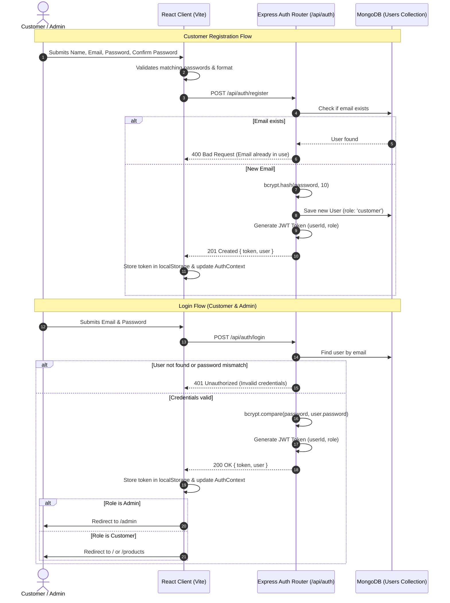
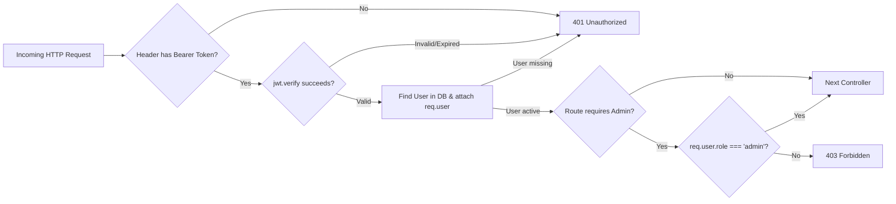

# Authentication & Authorization Architecture

This document describes the design and implementation specifications for the JWT authentication and role-based authorization system in the application.

---

## 1. Authentication Flow Diagram



---

## 2. Password Security with bcrypt

### 2.1 Password Hashing Strategy
- Salt Work Factor: `10` rounds (provides strong resistance against brute-force while keeping request latency under ~80ms).
- Passwords are never logged, never transmitted in plaintext over API responses, and never stored unhashed.

### 2.2 Pre-Save Hook Implementation Pattern
```javascript
import bcrypt from 'bcryptjs';

userSchema.pre('save', async function (next) {
  if (!this.isModified('password')) {
    return next();
  }
  const salt = await bcrypt.genSalt(10);
  this.password = await bcrypt.hash(this.password, salt);
  next();
});

// Instance method for password comparison
userSchema.methods.comparePassword = async function (enteredPassword) {
  return await bcrypt.compare(enteredPassword, this.password);
};
```

---

## 3. JWT Token Generation & Structure

### 3.1 Token Payload
The token payload encapsulates only the minimal identifiers needed to authorize requests without querying sensitive fields:
```json
{
  "id": "651a1f0a2e5c8e31a9b1c002",
  "role": "admin",
  "iat": 1727856000,
  "exp": 1728460800
}
```

### 3.2 Token Generation Utility (`server/utils/generateToken.js`)
```javascript
import jwt from 'jsonwebtoken';

export const generateToken = (userId, role) => {
  return jwt.sign(
    { id: userId, role },
    process.env.JWT_SECRET || 'fallback_secret_for_demo',
    { expiresIn: '7d' }
  );
};
```

---

## 4. Middleware Pipeline



### 4.1 Authentication Middleware (`middleware/authMiddleware.js`)
- Inspects the `Authorization` request header for format `Bearer <token>`.
- Decodes the token using `jwt.verify`.
- Fetches the current user from MongoDB excluding password: `.select('-password')`.
- Appends user to Express `req.user`.

```javascript
import jwt from 'jsonwebtoken';
import User from '../models/User.js';

export const protect = async (req, res, next) => {
  let token;
  const authHeader = req.headers.authorization;

  if (authHeader && authHeader.startsWith('Bearer ')) {
    try {
      token = authHeader.split(' ')[1];
      const decoded = jwt.verify(token, process.env.JWT_SECRET);
      req.user = await User.findById(decoded.id).select('-password');
      
      if (!req.user) {
        return res.status(401).json({ success: false, message: 'User no longer exists' });
      }

      return next();
    } catch (error) {
      return res.status(401).json({ success: false, message: 'Invalid or expired token' });
    }
  }

  if (!token) {
    return res.status(401).json({ success: false, message: 'Authorization token required' });
  }
};
```

### 4.2 Admin Middleware (`middleware/adminMiddleware.js`)
- Runs after `protect`.
- Ensures `req.user` has `role === 'admin'`.

```javascript
export const requireAdmin = (req, res, next) => {
  if (req.user && req.user.role === 'admin') {
    return next();
  }
  return res.status(403).json({
    success: false,
    message: 'Access denied: Administrator privileges required',
  });
};
```

---

## 5. Client-Side Authentication State & Axios Interceptor

### 5.1 Local Storage Persistence
- On successful login/registration, token and user data are stored:
  - `localStorage.setItem('ecomm_token', token)`
  - `localStorage.setItem('ecomm_user', JSON.stringify(user))`
- On logout:
  - `localStorage.removeItem('ecomm_token')`
  - `localStorage.removeItem('ecomm_user')`

### 5.2 Axios Interceptor Setup (`client/src/services/api.js`)
```javascript
import axios from 'axios';

const api = axios.create({
  baseURL: import.meta.env.VITE_API_BASE_URL || 'http://localhost:5000/api',
});

// Request Interceptor: Attach Bearer token
api.interceptors.request.use(
  (config) => {
    const token = localStorage.getItem('ecomm_token');
    if (token) {
      config.headers.Authorization = `Bearer ${token}`;
    }
    return config;
  },
  (error) => Promise.reject(error)
);

// Response Interceptor: Catch 401 and auto logout
api.interceptors.response.use(
  (response) => response,
  (error) => {
    if (error.response && error.response.status === 401) {
      localStorage.removeItem('ecomm_token');
      localStorage.removeItem('ecomm_user');
      window.location.href = '/login';
    }
    return Promise.reject(error);
  }
);

export default api;
```

---

## 6. Default Admin Seeding Strategy

For demo and testing convenience, an initial admin user can be seeded upon server startup or via a lightweight seed script:

- **Email:** `admin@ecomm.com`
- **Password:** `Admin@123`
- **Role:** `admin`

If the database has no admin user on boot, `server.js` checks and creates this default admin account with hashed password.
