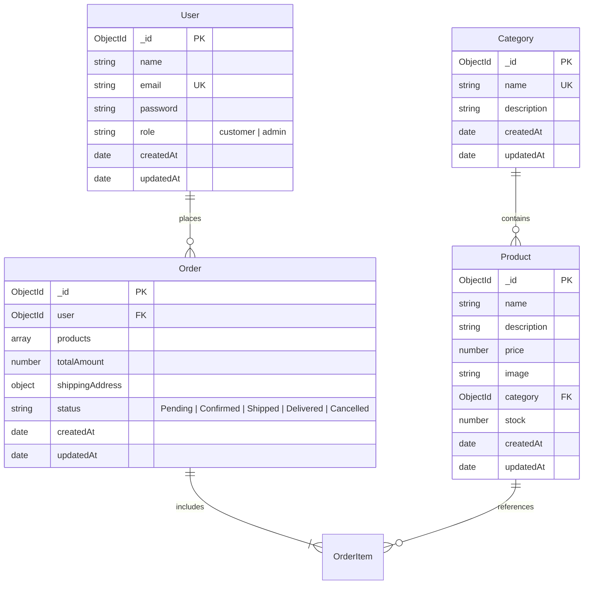

# Database Schema & Mongoose Models

This document defines the schema designs, data types, constraints, validation rules, indexes, and relationships for the four core MongoDB models in the application: **User**, **Category**, **Product**, and **Order**.

---

## 1. Entity-Relationship (ER) Diagram



---

## 2. Models Specification

### 2.1 User Model (`models/User.js`)

Represents registered customers and administrative staff.

#### Schema Definition
```javascript
import mongoose from 'mongoose';

const userSchema = new mongoose.Schema(
  {
    name: {
      type: String,
      required: [true, 'User name is required'],
      trim: true,
      minlength: [2, 'Name must be at least 2 characters long'],
      maxlength: [50, 'Name cannot exceed 50 characters'],
    },
    email: {
      type: String,
      required: [true, 'Email is required'],
      unique: true,
      trim: true,
      lowercase: true,
      match: [
        /^\w+([.-]?\w+)*@\w+([.-]?\w+)*(\.\w{2,3})+$/,
        'Please provide a valid email address',
      ],
    },
    password: {
      type: String,
      required: [true, 'Password is required'],
      minlength: [6, 'Password must be at least 6 characters long'],
    },
    role: {
      type: String,
      enum: {
        values: ['customer', 'admin'],
        message: '{VALUE} is not a valid user role',
      },
      default: 'customer',
    },
  },
  {
    timestamps: true,
  }
);
```

#### Field Details
| Field | Type | Required | Constraints / Default | Description |
| :--- | :--- | :--- | :--- | :--- |
| `name` | String | Yes | Trimmed, 2–50 chars | Full name of the user |
| `email` | String | Yes | Unique, Lowercase, Regex email validation | User account login email |
| `password` | String | Yes | Min 6 chars (bcrypt hashed) | Secure salted password hash |
| `role` | String | Yes | Enum: `['customer', 'admin']`, default: `'customer'` | Access control role |
| `createdAt` | Date | Auto | Timestamps enabled | Account creation timestamp |
| `updatedAt` | Date | Auto | Timestamps enabled | Last profile update timestamp |

---

### 2.2 Category Model (`models/Category.js`)

Represents product classification categories (e.g., Electronics, Fashion, Shoes).

#### Schema Definition
```javascript
import mongoose from 'mongoose';

const categorySchema = new mongoose.Schema(
  {
    name: {
      type: String,
      required: [true, 'Category name is required'],
      unique: true,
      trim: true,
      minlength: [2, 'Category name must be at least 2 characters long'],
      maxlength: [50, 'Category name cannot exceed 50 characters'],
    },
    description: {
      type: String,
      trim: true,
      default: '',
      maxlength: [250, 'Description cannot exceed 250 characters'],
    },
  },
  {
    timestamps: true,
  }
);
```

#### Field Details
| Field | Type | Required | Constraints / Default | Description |
| :--- | :--- | :--- | :--- | :--- |
| `name` | String | Yes | Unique, Trimmed, 2–50 chars | Name of category (e.g. "Electronics") |
| `description`| String | No | Trimmed, max 250 chars | Brief description of category products |
| `createdAt` | Date | Auto | Timestamps enabled | Creation timestamp |
| `updatedAt` | Date | Auto | Timestamps enabled | Last modification timestamp |

---

### 2.3 Product Model (`models/Product.js`)

Represents individual items sold in the store.

#### Schema Definition
```javascript
import mongoose from 'mongoose';

const productSchema = new mongoose.Schema(
  {
    name: {
      type: String,
      required: [true, 'Product name is required'],
      trim: true,
      minlength: [2, 'Product name must be at least 2 characters long'],
      maxlength: [120, 'Product name cannot exceed 120 characters'],
    },
    description: {
      type: String,
      required: [true, 'Product description is required'],
      trim: true,
      maxlength: [2000, 'Description cannot exceed 2000 characters'],
    },
    price: {
      type: Number,
      required: [true, 'Product price is required'],
      min: [0.01, 'Price must be greater than zero'],
    },
    image: {
      type: String,
      required: [true, 'Product image URL is required'],
      trim: true,
    },
    category: {
      type: mongoose.Schema.Types.ObjectId,
      ref: 'Category',
      required: [true, 'Product must belong to a category'],
    },
    stock: {
      type: Number,
      required: [true, 'Available stock count is required'],
      min: [0, 'Stock cannot be negative'],
      default: 0,
    },
  },
  {
    timestamps: true,
  }
);

// Compound index for category lookup & name text search
productSchema.index({ category: 1, name: 'text' });
```

#### Field Details
| Field | Type | Required | Constraints / Default | Description |
| :--- | :--- | :--- | :--- | :--- |
| `name` | String | Yes | Trimmed, 2–120 chars | Commercial title of the product |
| `description`| String | Yes | Trimmed, max 2000 chars | Detailed product specifications |
| `price` | Number | Yes | Min: 0.01 (positive number) | Retail price in currency units |
| `image` | String | Yes | Valid image URL | Web accessible image URL |
| `category` | ObjectId | Yes | References `Category` model | Foreign key to product category |
| `stock` | Number | Yes | Min: 0, default: 0 | Available inventory count |
| `createdAt` | Date | Auto | Timestamps enabled | Creation timestamp |
| `updatedAt` | Date | Auto | Timestamps enabled | Last modification timestamp |

---

### 2.4 Order Model (`models/Order.js`)

Represents a completed customer purchase.

#### Schema Definition
```javascript
import mongoose from 'mongoose';

const orderItemSchema = new mongoose.Schema(
  {
    product: {
      type: mongoose.Schema.Types.ObjectId,
      ref: 'Product',
      required: true,
    },
    name: {
      type: String,
      required: true,
    },
    price: {
      type: Number,
      required: true,
      min: [0.01, 'Price must be positive'],
    },
    quantity: {
      type: Number,
      required: true,
      min: [1, 'Quantity must be at least 1'],
    },
    image: {
      type: String,
      required: true,
    },
  },
  { _id: false }
);

const shippingAddressSchema = new mongoose.Schema(
  {
    name: {
      type: String,
      required: [true, 'Recipient name is required'],
      trim: true,
    },
    phone: {
      type: String,
      required: [true, 'Contact phone number is required'],
      trim: true,
    },
    address: {
      type: String,
      required: [true, 'Street address is required'],
      trim: true,
    },
    city: {
      type: String,
      required: [true, 'City is required'],
      trim: true,
    },
    pincode: {
      type: String,
      required: [true, 'Pincode / Postal code is required'],
      trim: true,
    },
  },
  { _id: false }
);

const orderSchema = new mongoose.Schema(
  {
    user: {
      type: mongoose.Schema.Types.ObjectId,
      ref: 'User',
      required: [true, 'Order must belong to a registered user'],
    },
    products: {
      type: [orderItemSchema],
      required: [true, 'Order must contain at least one product'],
      validate: {
        validator: function (items) {
          return items && items.length > 0;
        },
        message: 'Order items array cannot be empty',
      },
    },
    totalAmount: {
      type: Number,
      required: true,
      min: [0.01, 'Total amount must be greater than zero'],
    },
    shippingAddress: {
      type: shippingAddressSchema,
      required: true,
    },
    paymentMethod: {
      type: String,
      default: 'COD',
      enum: ['COD'],
    },
    status: {
      type: String,
      required: true,
      enum: {
        values: ['Pending', 'Confirmed', 'Shipped', 'Delivered', 'Cancelled'],
        message: '{VALUE} is not a valid order status',
      },
      default: 'Pending',
    },
  },
  {
    timestamps: true,
  }
);

orderSchema.index({ user: 1, createdAt: -1 });
```

#### Field Details
| Field | Type | Required | Constraints / Default | Description |
| :--- | :--- | :--- | :--- | :--- |
| `user` | ObjectId | Yes | References `User` model | Customer who placed order |
| `products` | Array | Yes | Array of snapshot item subdocs | Items ordered (snapshot price & name) |
| `totalAmount` | Number | Yes | Calculated server-side | Total order payable value |
| `shippingAddress`| Subdocument | Yes | Embedded address schema | Recipient name, phone, address, city, pincode |
| `paymentMethod`| String | Yes | Fixed: `'COD'` | Only Cash on Delivery supported |
| `status` | String | Yes | Enum: `['Pending', 'Confirmed', 'Shipped', 'Delivered', 'Cancelled']` | Order lifecycle stage (default: `Pending`) |
| `createdAt` | Date | Auto | Timestamps enabled | Placement timestamp |
| `updatedAt` | Date | Auto | Timestamps enabled | Last status update timestamp |

---

## 3. Data Integrity & Stock Management Rules

1. **Snapshotting in Orders:** In `Order.products`, the product `name`, `price`, and `image` are copied at the moment of order creation. If a product's price or description changes in the future, past orders remain legally accurate.
2. **Stock Atomic Decrement:**
   When an order is submitted:
   ```javascript
   // Query current stock and verify availability
   const product = await Product.findById(item.productId);
   if (!product || product.stock < item.quantity) {
     throw new Error(`Insufficient stock for product: ${item.name}`);
   }
   
   // Decrement stock
   product.stock -= item.quantity;
   await product.save();
   ```
3. **Restoring Stock on Cancellation:** If an order status changes to `Cancelled`, the backend logic optionally restores the inventory quantity.
