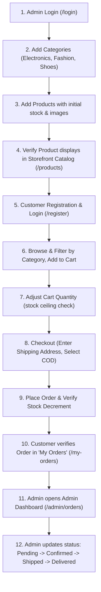

# End-to-End Demo Walkthrough Script

This document provides a step-by-step execution script for running the complete demonstration of the **Mini E-Commerce Demo Project**. Follow these exact steps to demonstrate all customer and administrative workflows.

---

## 🎯 Demo Storyboard Overview

---

## Step 1: Admin Authentication

1. Navigate to `http://localhost:5173/login`.
2. Enter the administrator credentials:
   - **Email:** `admin@ecomm.com`
   - **Password:** `Admin@123`
3. Click **"Sign In"**.
4. **Expected Result:**
   - Toast alert: `"Login successful. Welcome Admin!"`
   - Automated redirect to Admin Dashboard (`/admin`).
   - Admin navigation sidebar appears on the left.

---

## Step 2: Create Categories

1. In the Admin sidebar, click **"Categories"** (`/admin/categories`).
2. Click the **"+ Add Category"** button.
3. Enter Category details:
   - **Name:** `Electronics`
   - **Description:** `Smart gadgets, smartphones, audio devices, and computer accessories`
4. Click **"Save Category"**.
5. Repeat for:
   - **Name:** `Fashion` | **Description:** `Clothing, daily wear, and apparel`
   - **Name:** `Shoes` | **Description:** `Running shoes, sneakers, and casual footwear`
6. **Expected Result:**
   - Toast alert: `"Category created successfully"`.
   - The Categories table refreshes and lists the 3 categories with their descriptions.

---

## Step 3: Add Products

1. In the Admin sidebar, click **"Products"** (`/admin/products`).
2. Click **"+ Add Product"**.
3. Fill out the Product form:
   - **Product Name:** `Ultra Wireless Headphones`
   - **Category:** Select `Electronics`
   - **Price ($):** `79.99`
   - **Stock Count:** `15`
   - **Image URL:** `https://images.unsplash.com/photo-1505740420928-5e560c06d30e?w=600`
   - **Description:** `High-fidelity wireless over-ear headphones with noise cancellation and 30-hour battery life.`
4. Click **"Save Product"**.
5. Repeat to add a second product:
   - **Product Name:** `Classic Urban Running Shoes`
   - **Category:** Select `Shoes`
   - **Price ($):** `54.50`
   - **Stock Count:** `10`
   - **Image URL:** `https://images.unsplash.com/photo-1542291026-7eec264c27ff?w=600`
   - **Description:** `Ergonomic cushioned running shoes with breathable mesh and anti-slip sole.`
6. **Expected Result:**
   - Toast alert: `"Product created successfully"`.
   - Products table shows both items with images, prices, and green "In Stock" badges.

---

## Step 4: Verify Public Storefront Display

1. Click **"View Store"** in the top navigation bar or navigate to `http://localhost:5173/`.
2. Notice the featured products displayed on the Home page.
3. Click **"Products"** in the top navigation bar.
4. **Expected Result:**
   - Both products appear in the responsive product grid.
   - Category filter pills render: `All`, `Electronics`, `Fashion`, `Shoes`.
5. Test Category Filtering:
   - Click `Electronics` → Only "Ultra Wireless Headphones" is displayed.
   - Click `Shoes` → Only "Classic Urban Running Shoes" is displayed.
   - Click `All` → All products are displayed.
6. Test Search:
   - Type `Headphones` into the search bar → Only headphones card remains visible.

---

## Step 5: Customer Account Registration

1. Log out of the admin account by clicking **"Logout"**.
2. Click **"Register"** in the top navigation bar (`/register`).
3. Fill in registration details:
   - **Full Name:** `Alex Customer`
   - **Email:** `alex@example.com`
   - **Password:** `alex123`
   - **Confirm Password:** `alex123`
4. Click **"Create Account"**.
5. **Expected Result:**
   - Toast alert: `"Account created successfully! Welcome Alex."`
   - Logged-in state activates; Navbar shows `"Alex"`, `"My Orders"`, and `"Logout"`.

---

## Step 6 & 7: Add Products to Cart & Enforce Stock Limit

1. On the Products catalog page, click **"Add to Cart"** on `Ultra Wireless Headphones`.
   - Toast notification: `"Added to cart"`.
   - Cart badge in the Navbar shows `(1)`.
2. Click the Cart icon to open `/cart`.
3. Try incrementing quantity using `[+]`:
   - Increase to 2. Total price recalculates to `2 × $79.99 = $159.98`.
   - Note: If quantity reaches 15 (available stock), the `[+]` button is automatically disabled and prevents over-ordering.

---

## Step 8 & 9: Checkout & Cash on Delivery Order Placement

1. Click **"Proceed to Checkout"** (`/checkout`).
2. Fill in the Shipping Address fields:
   - **Full Name:** `Alex Customer`
   - **Phone Number:** `+1 (555) 234-5678`
   - **Street Address:** `456 Pine Boulevard, Suite 12`
   - **City:** `Seattle`
   - **Pincode:** `98101`
3. Notice payment method is set to **Cash on Delivery (COD)**.
4. Click **"Place Order (Cash on Delivery)"**.
5. **Expected Result:**
   - Order creation API executes: validates price from MongoDB, reduces stock by 2 units.
   - Cart is automatically cleared (`totalItems = 0`).
   - Toast alert: `"Order placed successfully!"`.
   - Redirect to `/my-orders`.

---

## Step 10: Customer Verifies Order in "My Orders"

1. On the `/my-orders` page:
   - View newly placed order with Order ID (e.g., `#651a...`).
   - Total amount correctly calculated (`$159.98`).
   - Status badge displays **"Pending"** in yellow/amber.
   - Shipping details match entered information.

---

## Step 11 & 12: Admin Reviews Order & Updates Lifecycle

1. Log out of customer account and log back in as Admin (`admin@ecomm.com` / `Admin@123`).
2. Navigate to **"Orders"** in the Admin sidebar (`/admin/orders`).
3. Locate Alex Customer's order:
   - Notice current status is **Pending**.
4. Check inventory verification:
   - Navigate to `/admin/products`.
   - Notice `Ultra Wireless Headphones` stock decreased from **15** to **13**.
5. Return to `/admin/orders`.
6. Use the Status selector to advance the order:
   - Change `Pending` → **`Confirmed`** (Status badge turns blue).
   - Change `Confirmed` → **`Shipped`** (Status badge turns purple).
   - Change `Shipped` → **`Delivered`** (Status badge turns green).
7. **Expected Result:**
   - Toast alert confirms: `"Order status updated to Delivered"`.
   - The status is persisted to MongoDB. If Alex logs back in, their `/my-orders` page immediately reflects the **Delivered** status.
