# Implementation Plan & Coding Roadmap

This document outlines the phased coding roadmap for implementing the Mini E-Commerce project using the MERN stack.

---

## 📅 Phased Implementation Roadmap

```mermaid
gantt
    title MERN Mini E-Commerce Coding Roadmap
    dateFormat  X
    axisFormat %s
    section Phase 1: Environment & Server Foundation
    Server scaffolding & DB connection      :p1_1, 0, 1
    Mongoose Schemas (User, Cat, Prod, Order):p1_2, 1, 2
    section Phase 2: Auth & Middleware
    JWT & bcrypt utility implementation    :p2_1, 2, 3
    Auth & Admin Middleware                 :p2_2, 3, 4
    section Phase 3: REST API Controllers
    Category CRUD endpoints                 :p3_1, 4, 5
    Product CRUD, Filter & Search           :p3_2, 5, 6
    Order creation & stock deduction        :p3_3, 6, 7
    section Phase 4: Client Setup & UI Scaffold
    Vite + React + Tailwind setup          :p4_1, 7, 8
    Auth & Cart React Contexts              :p4_2, 8, 9
    Axios API layer with interceptor        :p4_3, 9, 10
    section Phase 5: Client Storefront Pages
    Navbar, Footer, Home & Products Catalog :p5_1, 10, 11
    Cart page with stock boundary checks   :p5_2, 11, 12
    Checkout form & My Orders view          :p5_3, 12, 13
    section Phase 6: Admin Dashboard
    Admin Sidebar & Layout                  :p6_1, 13, 14
    Category & Product management modals    :p6_2, 14, 15
    Orders management & status transition   :p6_3, 15, 16
```

---

## Phase 1: Server Scaffolding & Database Models

### Tasks:
1. Initialize `/server` with `package.json` (`express`, `mongoose`, `dotenv`, `cors`, `bcryptjs`, `jsonwebtoken`).
2. Establish MongoDB connection in `config/db.js` with error logging.
3. Construct Mongoose models matching `docs/DATABASE_MODELS.md`:
   - `User.js` (with bcrypt `pre('save')` hook and `comparePassword` method)
   - `Category.js`
   - `Product.js` (with text indexing on `name`)
   - `Order.js` (with snapshot items and COD enum)

---

## Phase 2: Authentication & Route Protection

### Tasks:
1. Implement token generator utility `utils/generateToken.js`.
2. Construct `authMiddleware.js` (`protect`) to verify Bearer tokens.
3. Construct `adminMiddleware.js` (`requireAdmin`) to restrict routes to `role === 'admin'`.
4. Build `authController.js` and `authRoutes.js`:
   - `POST /api/auth/register`
   - `POST /api/auth/login`
5. Test auth routes with Postman/cURL (verify hash and JWT issue).

---

## Phase 3: Express REST Controllers & Business Logic

### Tasks:
1. **Category Controller (`categoryController.js` & `categoryRoutes.js`):**
   - `GET /api/categories` (Public)
   - `POST /api/categories` (Admin)
   - `PUT /api/categories/:id` (Admin)
   - `DELETE /api/categories/:id` (Admin)
2. **Product Controller (`productController.js` & `productRoutes.js`):**
   - `GET /api/products` (Public; filters by `?category=` and searches by `?search=`)
   - `GET /api/products/:id` (Public)
   - `POST /api/products` (Admin)
   - `PUT /api/products/:id` (Admin)
   - `DELETE /api/products/:id` (Admin)
3. **Order Controller (`orderController.js` & `orderRoutes.js`):**
   - `POST /api/orders` (Authenticated customer):
     - Validates stock.
     - Calculates total price directly from MongoDB prices.
     - Decrements product stock.
     - Saves order.
   - `GET /api/orders/my-orders` (Authenticated customer).
   - `GET /api/admin/orders` (Admin).
   - `PATCH /api/admin/orders/:id/status` (Admin).

---

## Phase 4: Frontend Scaffolding, Context & API Layer

### Tasks:
1. Initialize `/client` with Vite (`npm create vite@latest client -- --template react`).
2. Configure Tailwind CSS (`tailwind.config.js`, `postcss.config.js`, `@tailwind` directives in `index.css`).
3. Set up Axios client in `services/api.js` with base URL and JWT interceptors.
4. Build `AuthContext.jsx` for persistent login state (`localStorage`).
5. Build `CartContext.jsx` for persistent shopping cart with inventory clamping.
6. Configure React Router routes in `App.jsx` with protected route wrappers (`ProtectedRoute.jsx`).

---

## Phase 5: Customer Storefront Implementation

### Tasks:
1. Create `Navbar.jsx` with responsive drawer, cart badge, and auth dropdown.
2. Build `Home.jsx` with hero section and featured categories.
3. Build `Products.jsx` with Category filter pills (`All | Electronics | Fashion | Shoes`), search input, and responsive grid (`ProductCard.jsx`).
4. Build `ProductDetails.jsx` with large image, description, and "Add to Cart" button.
5. Build `Cart.jsx` with item row, quantity stepper `[-] [+]`, item removal, and subtotal.
6. Build `Checkout.jsx` with shipping address form, COD order placement button, and cart clearing.
7. Build `MyOrders.jsx` displaying customer's order history and status badges.
8. Build `Login.jsx` and `Register.jsx` pages with validation feedback.

---

## Phase 6: Admin Dashboard Implementation

### Tasks:
1. Create `AdminLayout.jsx` with persistent sidebar navigation and header.
2. Build `AdminDashboard.jsx` summary overview.
3. Build `AdminCategories.jsx` table with Add/Edit modal dialogs and Delete confirmation.
4. Build `AdminProducts.jsx` table with image thumbnails, price, stock badges, Add/Edit modals, and Delete confirmation.
5. Build `AdminOrders.jsx` table with customer details, order items breakdown, and Status change dropdown.

---

## Phase 7: Verification & End-to-End Testing

### Tasks:
1. Execute full flow per `docs/DEMO_WALKTHROUGH.md`.
2. Verify pricing cannot be manipulated by client requests.
3. Verify product stock is decremented accurately upon checkout.
4. Check responsive design on Mobile (375px), Tablet (768px), and Desktop (1280px).
